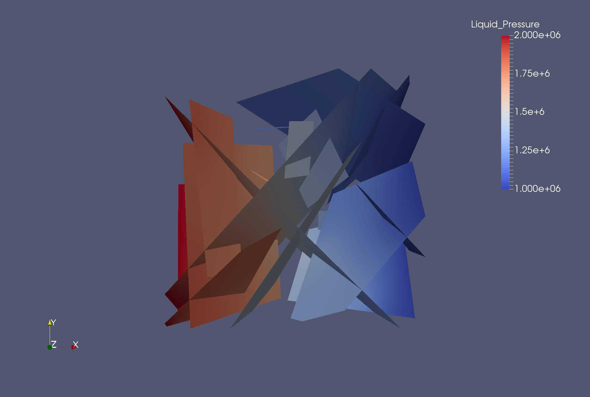
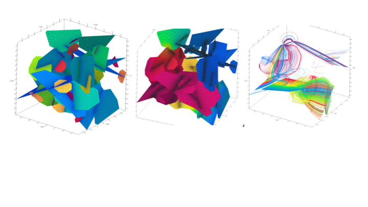
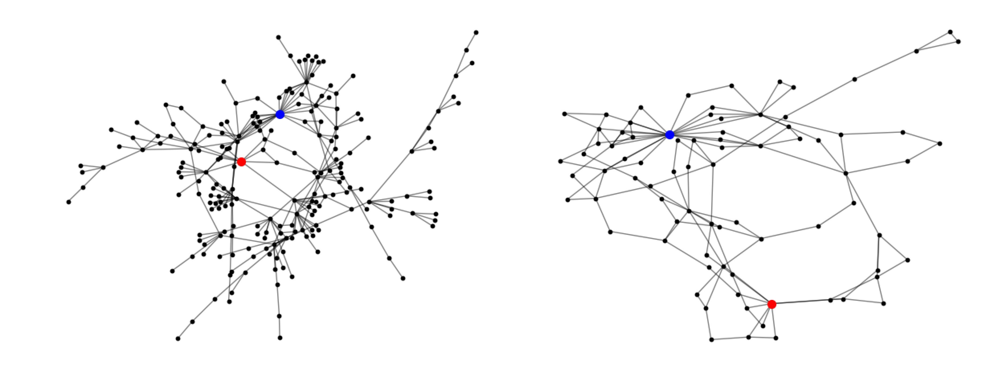

Examples
=============================

This section contains a few examples of DFN generated using dfnWorks. All required input files for these examples are contained in the folder dfnWorks/examples/. The focus of this document is to provide visual confirmation that new users of dfnWorks have the code set up correctly, can carry out the following runs and reproduce the following images. All images are rendered using Paraview, which can be obtained for free at https://www.paraview.org/. The first two examples are simplest so it is recommended that the user proceed in the order presented here. 

All examples are in the examples/ directory. Within each subdirectory are the files required to run the example. Each example is run from its own directory with

.. code-block:: bash

    $ python driver.py

Output is written to the ``output/`` sub-directory of the example. The regression suite in ``tests/regression`` runs the examples and compares their results against stored baselines (``python3 run_regression.py`` from that directory; see ``tests/regression/README.md``).

4_user_rects
--------------------------

Location: examples/4_user_rects/

This test case consists of four user defined rectangular fractures within a a cubic domain with sides of length one meter. The network of four fractures, each colored by material ID. The computational mesh is overlaid on the fractures. This image is created by loading the file full_mesh.inp. located in the job folder into Paraview.

.. figure:: figures/4_user_rectangles.png
   :scale: 10 %
   :alt: alternate text
   :align: center
	
   *The meshed network of four rectangular fractures.*

High pressure (red) Dirichlet boundary conditions are applied on the edge of the single fracture along the boundary x = -0.5, and low pressure (blue) boundary conditions are applied on the edges of the two fractures at the boundary x = 0.5.
This image is created by loading the file ``pflotran_vtu_outputs/dfn_explicit.pvd`` into Paraview and stepping to the final time.

Particles are inserted uniformly along the inlet fracture on the left side of the image. 
Particles exit the domain through the two horizontal fractures on the right side of the image.  
Due to the stochastic nature of the particle tracking algorithm, your pathlines might not be exactly the same as in this image. 
Trajectories are colored by the current velocity magnitude of the particle's velocity. 
Trajectories can be visualized by loading the files part\_*.inp, in the folder output/traj/trajectories/

We have used the extract surface and tube filters in paraview for visual clarity. 

4_user_ell_uniform
--------------------------

Location: examples/4_user_ell_uniform/

This test case consists of four user defined elliptical fractures within a a cubic domain with sides of length one meter. In this case the ellipses are approximated using 8 vertices. We have set the meshing resolution to be uniform by including the argument ``uniform_mesh=True`` in the ``mesh_network`` call in driver.py. 

.. figure:: figures/4_user_ellipses.png
   :scale: 10 %
   :alt: alternate text
   :align: center

   *The uniformly meshed network of four circular fractures.*

exp: Exponentially Distributed fracture lengths
-----------------------------------------------------

Location: examples/exp/

This test case consists of a family of fractures whose size is exponentially distributed with a minimum size of 1m and a maximum size of 50m. The domain is cubic with an edge length of 10m. All input parameters for the generator can be found in tests/gen_exponential_dist.dat.  We have changed the flow direction to be aligned with the y-axis by modifying the PFLOTRAN input card dfn_explicit.in

   *Pressure solution on with rectangular fractures whose lengths following a exponential distribution. Gradient is aligned with the Y-Axis*

TPL: Truncated Power-Law
----------------------------------

Location: examples/TPL/

This test case consists of a family whose sizes have a truncated power law (TPL) distribution with a minimum size of 1m and a maximum size of 10m an exponent 1.8. The domain size is cubic with an edge length of 15m. 

High pressure (red) Dirichlet boundary conditions are applied on the edge of the fractures along the boundary X = -7.5, and low pressure (blue) boundary conditions are applied on the edges of the fractures at the boundary X = 7.5.

dfnTrans starts from reconstruction of local velocity field: Darcy fluxes obtained using dfnFlow are used to reconstruct the local velocity field, which is used for particle tracking on the DFN.

Graph-based pruning
----------------------

Location: examples/pruning/

This example uses a graph representation of a DFN to isolate the 2-core. The pruned DFN has all dead end fractures of the network are removed. This example has two run_explicit.py scripts. The first creates the original DFN and identifies the 2-core using networkx (https://networkx.github.io/). The second meshes the DFN corresponding to the 2-core of the graph and then runs flow and transport. The 2 core network is in a sub-directory 2-core. The original network has 207 fractures and the 2-core has 79 fractures.

   *(left) Graph based on DFN topology. Each vertex is a fracture in the network. The inflow boundary is colored blue and the outflow is colored red. (right) 2-Core of the graph to the left.*

.. figure:: figures/pruned_network.png
   :scale: 5 %
   :alt: alternate text
   :align: center

   *(left) Original DFN (right) DFN corresponding to the 2-core of the DFN to the left.*

Additional Examples
---------------------

The following examples show other features of dfnWorks. See the ``driver.py`` (and ``README.md``, where present) in each directory for details.

Example: two_fracture_case
^^^^^^^^^^^^^^^^^^^^^^^^^^

Location: examples/two_fracture_case/

Two intersecting user-defined rectangular fractures in a 2 m x 1 m x 1 m domain. The full workflow is shown step by step: generation, meshing, PFLOTRAN flow, effective permeability, and particle tracking with DFNTrans. This is a good first example for checking a new installation.

Example: regions
^^^^^^^^^^^^^^^^

Location: examples/regions/

Assigns a dense fracture family to a cubic sub-region of the domain (:ref:`numOfRegions`, :ref:`regions`) and two sparser families to the whole domain.

Example: layers
^^^^^^^^^^^^^^^

Location: examples/layers/

Two layers with large fractures that cross the layer interface. Change ``LAYER_CONFORMING`` at the top of ``driver.py`` to compare the three :ref:`layerConformingFractures` modes.

Example: polygon_domain_boundary
^^^^^^^^^^^^^^^^^^^^^^^^^^^^^^^^

Location: examples/polygon_domain_boundary/

Generates and meshes a network inside an irregular boundary in the x-y plane read from ``vertices.dat`` (:ref:`polygonBoundaryFlag`, :ref:`polygonBoundaryFile`).

Example: bingham_distribution
^^^^^^^^^^^^^^^^^^^^^^^^^^^^^

Location: examples/bingham_distribution/

Four fracture families with Bingham-distributed orientations: a round cap, an elliptical cap, an elliptical girdle, and asymmetric lobes. See :ref:`Bingham Distribution`.

Example: calibrate_p32_from_p10
^^^^^^^^^^^^^^^^^^^^^^^^^^^^^^^

Location: examples/calibrate_p32_from_p10/

Calibrates a family's P32 to match an observed P10 along a borehole. A synthetic well is placed in the center of the domain, networks are generated for trial P32 values, and a root-finding method adjusts P32 until the number of fractures intersecting the well matches the target. This can take a while to run.

Example: graph_transport
^^^^^^^^^^^^^^^^^^^^^^^^

Location: examples/graph_transport/

Graph-based flow and particle transport on a 400 m x 50 m x 50 m network with ``run_graph_flow`` and ``run_graph_transport`` (see :ref:`dfnWorks-python-chapter-dfnGraph`). The network is not meshed. ``make_btc.py`` computes breakthrough curves from the particle travel times.

Example: tdrw
^^^^^^^^^^^^^

Location: examples/tdrw/

Particle tracking with matrix diffusion using DFNTrans. The time domain random walk (TDRW) is turned on in ``PTDFN_control_tdrw.dat`` with ``tdrw: yes``, ``tdrw_porosity``, and ``tdrw_diffcoeff``.

Example: finite_matrix_diffusion
^^^^^^^^^^^^^^^^^^^^^^^^^^^^^^^^

Location: examples/finite_matrix_diffusion/

Finite matrix diffusion in graph-based transport on a Forsmark-like network. ``forsmark_percolation_comparison.py`` sweeps fracture spacing and matrix diffusivity with the ``'dentz'`` TDRW model and compares the results to the infinite-matrix model. ``plot_fmd_demo.py`` makes the figures. See :ref:`Matrix Diffusion (TDRW)`.

Example: udfm
^^^^^^^^^^^^^

Location: examples/udfm/

Upscales a four-fracture network onto an octree-refined continuum mesh with ``map_to_continuum`` and ``upscale`` (UDFM), writing anisotropic permeability and porosity for PFLOTRAN.

Example: mapdfn
^^^^^^^^^^^^^^^

Location: examples/mapdfn/

Maps a 1 km DFN with three stochastic families and four deterministic fractures onto a uniform equivalent continuous porous medium (ECPM) grid with ``mapdfn_ecpm``, then runs PFLOTRAN flow and transport on the continuum grid.
